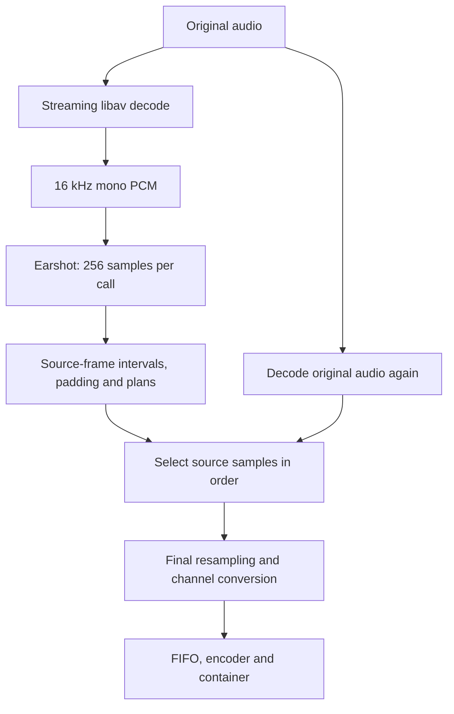

# SmartAudio — ASR Audio Preprocess

[中文](README_ZH.md)

A synchronous Rust library and thin CLI for preparing audio for ASR APIs.
Speech detection uses **Earshot `=1.2.2`**. Decoding, sample selection, conversion,
encoding and muxing use **statically linked FFmpeg/libav 8.1.2**. The runtime
does not launch `ffmpeg` or `ffprobe`. Rust **1.98.1** is required.

Microphone capture, GUI, upload/authentication, ASR request concurrency, retries
and transcript merging belong to the caller.

## Modes

| Mode | Behavior | Destination |
|---|---|---|
| `process` | Detect speech, trim non-speech, plan bounded chunks | Directory |
| `trim` | Detect speech, trim and concatenate | One file |
| `split` | Detect speech to guide boundaries; retain internal pauses by default | Directory |
| `preconvert` | Convert the whole input without VAD | One file |

The three speech modes always run Earshot. `analyze` returns speech intervals
without exporting files. No speech produces `no_speech`, with no empty output
and no automatic whole-input conversion.

## Processing



Analysis PCM never feeds the output encoder. There are no analysis/intermediate
WAVs, whole-recording PCM buffers, filtergraphs, repeated VAD, or one full decode
per chunk. A normal speech task decodes the input twice; `preconvert` decodes it once.
Except for PCM/lossless and Ogg/Opus, encoded outputs are also stream-decoded
to check actual duration, without retaining PCM. These
checks are counted separately as `output_validation_decodes`.
Output files are staged in a task-specific work directory, then published
without overwriting. Errors/cancellation clean staged files; publication errors
roll back files created by that call.

Intervals are half-open `[start_frame, end_frame)`, measured in frames **per
channel**. Start mapping rounds down and end mapping rounds up. Outer padding
is applied in full. At internal joins the two sides share one padding budget;
gaps no longer than that budget are retained entirely. Odd source samples are
assigned to the following interval. Zero padding is valid.

## Rust API

Until a crates.io release exists, use a checkout as a path dependency:

```toml
[dependencies]
smartaudio = { path = "/path/to/ASR-Audio-Preprocess" }
```

```rust
use smartaudio::{Config, Control, Input, Processor};
use std::path::Path;

fn main() -> smartaudio::Result<()> {
    let processor = Processor;
    let input = Input::new("recording.m4a");
    let config = Config::default();
    let control = Control::default();
    let result = processor.process(&input, Path::new("chunks"), &config, &control)?;
    println!("{:?}: {} files", result.status, result.output_file_count);
    Ok(())
}
```

`trim`, `split` and `preconvert` have the same arguments. `run` uses `Config.mode`.
`analyze(&input, &control)` returns reusable `Analysis`; pass it to
`export_analysis(&input, destination, &config, &analysis, &control)` to reuse it.
Use `analyze_with_config(&input, &config.vad, &control)` for a custom onset
threshold. `analyze` defaults to 0.6. Export reuses detected intervals, so a
threshold change requires a new analysis. The allowed minimum is 0.5, matching
the fixed continuation threshold. CLI `analyze`, `process`, `trim` and `split`
accept `--vad-start-threshold`.
The source path, stream/raw settings, length and modification time are checked
before reuse. The caller must not modify the input while processing.

`Control.cancellation` is cloneable and may be cancelled from another thread.
`Control.progress` accepts a synchronous callback receiving phase, decoding and
diagnostic events. Callbacks execute on the processing thread. No async runtime
is required; the Rust library returns typed errors and does not exit the process.
The embedded libav logger is installed once; native calls capture diagnostics
per thread and attach native errors to returned failures instead of printing.
Applications sharing the same libav instance should not replace its global log
callback while SmartAudio is processing.

## Configuration and CLI

| Rust field | CLI option | Default |
|---|---|---|
| `vad.padding_ms` | `--vad-padding` | `100ms`, allowed `0..=1000ms` |
| `vad.start_threshold` | `--vad-start-threshold` | `0.6`, finite value in `0.5..=1.0` |
| `max_duration_ms` | `--max-duration` | `175s` |
| `max_bytes` | `--max-bytes` | No byte limit |
| `pauses` | `--pauses mode-default\|keep\|trim` | Per-mode behavior |
| `work_dir` | `--work-dir` | System temporary directory |
| `output.container` | `--container` | `ogg` |
| `output.encoder` | `--encoder` | `libopus` |
| `output.sample_rate` | `--sample-rate` | `16000` |
| `output.channels` | `--channels` | `1` |
| `output.bitrate` | `--bitrate` / `--no-bitrate` | `32k` |
| `output.sample_format` | `--sample-format` | Encoder's natural format |
| `output.threads` | `--native-threads` | `1`; `0` allows encoder auto-selection |
| `Input.stream` | `--input-stream` | Best audio stream |
| `Input.raw` | `--input-format`, `--input-rate`, `--input-channels` | Container autodetection |

Padding is the only public VAD setting. Duration and byte budgets apply to
multi-file modes; padding and retained pauses count toward the duration budget.
Continuous speech exceeding the budget is hard-cut and marked. Short tails
are retained. There is no automatic overlap. Byte limits are checked against
the **finished file**, including container overhead. Oversized plans are
bisected and re-exported from the original, at most 12 retry passes. Only
affected plans are encoded again; additional exports/decode passes are counted.

```sh
smartaudio process --input recording.m4a --output chunks
smartaudio trim --input recording.m4a --output speech.ogg --vad-padding 0ms
smartaudio split --input recording.m4a --output parts --max-duration 120s
smartaudio preconvert --input recording.m4a --output converted.wav \
  --container wav --encoder pcm_s16le --sample-rate 48000 --channels 2 --no-bitrate
smartaudio analyze --input recording.m4a
smartaudio formats
smartaudio preconvert --input capture.s24le --input-format s24le \
  --input-rate 44100 --input-channels 2 --output encoded.flac \
  --container flac --encoder flac --sample-rate 44100 --channels 2 --no-bitrate
```

Use the exact output extension reported by `formats`. Explicit sample formats
are strict libav names: `u8`, `s16`, `s32`, `s64`, `flt`, `dbl` and their planar
forms. A 24-bit PCM encoder receives `s32` samples. Use `--no-bitrate` (Rust
`None`) for PCM, lossless codecs and ADPCM. Invalid combinations fail rather
than silently changing codecs/formats or falling back to WAV. Ctrl-C requests
cancellation and cleanup.

## Formats

All four modes share the same registry. `smartaudio formats` returns compiled
container/encoder pairs, explicit runtime muxers and extensions. Native encoder
initialization additionally validates audio parameters.

| Family | Encoders |
|---|---|
| Lossy | `libopus`, `libmp3lame`, `mp2`, `aac`, `libvorbis`, `libspeex`, `libopencore_amrnb`, `libvo_amrwbenc`, `ac3`, `eac3`, `wmav1`, `wmav2`, `adpcm_ms` |
| Lossless | `flac`, `alac`, `wavpack` |
| Integer PCM | `pcm_s8`; signed 16/24/32/64-bit LE/BE |
| Floating PCM | 32/64-bit LE/BE |
| Companded PCM | `pcm_alaw`, `pcm_mulaw` |

Containers: WAV, MP3, Ogg, Opus, SPX, ADTS, AMR, AVI, FLAC, FLV, M4A,
Matroska, MOV, MP4, MPEG-PS, WebM, ASF/WMA, AIFF, WavPack, AC-3, E-AC-3
and registered raw PCM formats. These are **not a Cartesian product**.
There is no dedicated raw signed 64-bit PCM muxer. The `pcm_s64be` encoder is compiled, but FFmpeg 8.1.2 has
no verified pairing for it among the requested muxers, so it is not advertised
by `formats`. Signed 64-bit LE/WAV is verified. Raw input needs explicit
format/rate/channels. Corresponding audio demuxers, parsers and decoders are
compiled in; input is restricted to local, regular files.

Linux x86_64 tests cover 117 compiled pairs at suitable parameters. Opus needs
8/12/16/24/48 kHz; AMR-NB needs 8 kHz mono, AMR-WB 16 kHz mono. FLV G.711
requires 8 kHz. Consult validation results for limits; not every parameter
permutation or target has been verified.
AMR accepts only the codec's discrete bitrates; unsupported explicit rates are
errors. `None` / `--no-bitrate` selects 12200 bps for AMR-NB or 23850 bps for AMR-WB.

## Results and errors

Normal results are JSON on stdout; errors are JSON on stderr. Help/version
are text. Exit codes: `0` completed/no speech, `2` invalid configuration,
`130` cancelled, `1` other failure.

`ProcessingResult` includes protocol version/status, actual decoded input
properties, input/speech/retained/output durations, raw interval count, files,
phase timings, decode passes and extra exports. Each file includes source
intervals, output-frame mapping, a hard-cut flag, bytes, duration, container,
and the actual encoder/resampler rate, channels and sample format. Codec
delay or padding in formats without gapless metadata can affect playback
duration. Reported duration and chunk duration limits use actual playback
length, including those samples. `audio.frames` counts valid resampled content.
Output-frame mappings use the encoder's sample-rate grid and include leading
codec delay remaining after decoder skip metadata; they exclude trailing padding.
See `docs/validation.md` for the tested format parameters and alignment checks.

A no-speech result contains these fields (excerpt):

```json
{"protocol_version":1,"status":"no_speech","raw_interval_count":0,"output_file_count":0,"files":[],"decode_passes":1,"extra_exports":0}
```

Invalid configuration:

```json
{"protocol_version":1,"error":{"kind":"invalid_config","message":"vad padding must be 0..=1000 ms"}}
```

Successful statuses are `completed` and `no_speech`. Typed error kinds are
`invalid_config`, `detection`, `conversion`, `constraint`, `cancelled`, `io`.

## Build, tests and release

```sh
./scripts/bootstrap-static-audio-deps.sh
export PKG_CONFIG_PATH="$PWD/third_party/ffmpeg-audio/lib/pkgconfig"
cargo build --locked --release
cargo fmt --all --check
cargo clippy --locked --all-targets -- -D warnings
cargo test --locked
cargo run --locked --example library -- recording.m4a example-chunks
cargo package --locked --allow-dirty
```

The bootstrap requires a C/C++ compiler, make, autotools, pkg-config, curl and
tar/xz. It installs only into the project prefix. Source versions/checksums
are pinned in `scripts/audio-sources.sha256`; configure component lists are
centralized in `scripts/audio-components.sh` and checked before compilation.
`scripts/build-ffmpeg-audio-static.sh` can rebuild only FFmpeg with `FFMPEG_DIR`
and `PREFIX` set. Cargo consumers must provide the same static development
libraries through pkg-config. See [validation](docs/validation.md) for the
actual platform status and completion gates. No formal Rust release exists yet.

Release archives use `smartaudio-<platform>-<arch>` names, with platforms
`linux`, `windows`, `macos` and architectures `x86_64`, `arm64`.
Linux uses `.tar.gz`; Windows and macOS use `.zip`. Each archive contains the
binary and license notices and has a matching `.sha256` file. Packaging does
not generate additional source archives or vendor dependencies; ZIP packaging
requires `zip`.

## License

GPL-3.0-or-later. The native sample-copy implementation was informed by
STT-for-Windows (same author/license). See [third-party notices](THIRD_PARTY_NOTICES.md),
`THIRD_PARTY_LICENSES/` and the public fixture's provenance in `tests/fixtures/`.
