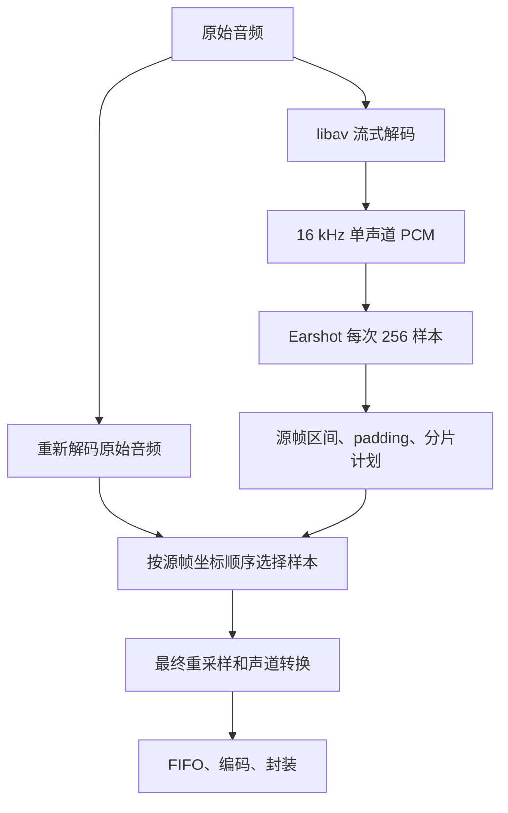

# SmartAudio — ASR 音频预处理

[English](README.md)

为 ASR API 准备音频的同步 **Rust 库和薄 CLI**。语音检测固定使用
**Earshot `=1.2.2`**，解码、样本裁剪、转换、编码和封装使用静态链接的
**FFmpeg/libav 8.1.3**。运行时不启动系统 `ffmpeg` 或 `ffprobe`。
Rust 工具链固定为 **1.99.1**。

麦克风录音、GUI、上传和鉴权、ASR 请求并发、重试、识别结果合并由调用方负责。

## 四种模式

| 模式 | 行为 | 输出位置 |
|---|---|---|
| `process` | 检测语音，裁剪非语音，按保留内容规划分片 | 目录 |
| `trim` | 检测语音，裁剪并拼接 | 一个文件 |
| `split` | 使用语音区间辅助分片，默认保留片内停顿 | 目录 |
| `preconvert` | 完整输入直接转换，不运行 VAD | 一个文件 |

前三种模式始终使用 Earshot。`analyze` 只分析并返回语音区间。
无语音返回 `no_speech`，不生成空文件，也不自动导出整段。

## 处理流程



分析 PCM 不会进入输出编码器。不生成分析或裁剪中间 WAV，不缓存整段 PCM，
不使用 filtergraph，不重复 VAD，不逐分片重复全量解码。正常语音流程解码两遍，
`preconvert` 解码一遍，这里统计的是原始输入的解码次数。除 PCM、无损编码和 Ogg/Opus
外，还会流式解码已编码输出，核对实际时长，不保存 PCM；这些核验单独计入
`output_validation_decodes`。输出先写入任务独立工作目录，完成后发布，默认不覆盖。
失败和取消清理临时产物；发布失败回滚本次已发布文件。

区间使用半开形式 `[start_frame, end_frame)`，帧表示每声道的位置。
分析到源音频的映射起点向下取整、终点向上取整。第一段之前和最后一段之后
最多保留完整 padding；内部拼接点两侧合计共享一个 padding。间隔不大于
padding 时完整保留。奇数源样本分配给后段一侧，零 padding 有效。

## Rust 库

正式发布到 crates.io 前，使用本地源码路径：

```toml
[dependencies]
smartaudio = { path = "/path/to/ASR-Audio-Preprocess" }
```

```rust
use smartaudio::{Config, Control, Input, Processor};
use std::path::Path;

fn main() -> smartaudio::Result<()> {
    let processor = Processor;
    let input = Input::new("recording.m4a");
    let config = Config::default();
    let control = Control::default();
    let result = processor.process(&input, Path::new("chunks"), &config, &control)?;
    println!("{:?}: {} files", result.status, result.output_file_count);
    Ok(())
}
```

`trim`、`split`、`preconvert` 参数相同；`run` 使用 `Config.mode`。
`analyze(&input, &control)` 返回可复用的 `Analysis`，再调用
`export_analysis(&input, destination, &config, &analysis, &control)` 导出。
自定义启动阈值使用 `analyze_with_config(&input, &config.vad, &control)`；
原有 `analyze` 默认使用 `0.6`。导出直接复用已检测的区间，改变阈值需要重新分析。
阈值下限为 `0.5`，与固定的延续阈值一致。CLI 的 `analyze`、`process`、`trim`、
`split` 均支持 `--vad-start-threshold`。
复用时检查输入路径、流和裸流配置、文件大小及修改时间。调用方应保证处理中不修改输入。

`Control.cancellation` 可以克隆，并在其他线程请求取消。
`Control.progress` 接收阶段、解码进度和诊断事件，同步运行在处理线程。
库不要求异步运行时，不退出调用方进程。Rust 核心返回类型化结果和错误；
内嵌 libav 的日志回调只初始化一次，原生调用按线程捕获诊断，将错误附到返回值，
不直接打印。共享同一 libav 实例的程序不应在 SmartAudio 处理期间替换其全局日志回调。

## 配置和 CLI

| Rust 字段 | CLI 参数 | 默认值 |
|---|---|---|
| `vad.padding_ms` | `--vad-padding` | `100ms`，范围 `0..=1000ms` |
| `vad.start_threshold` | `--vad-start-threshold` | `0.6`，范围 `0.5..=1.0`，不接受 NaN 或无穷大 |
| `max_duration_ms` | `--max-duration` | `175s` |
| `max_bytes` | `--max-bytes` | 不限制字节数 |
| `pauses` | `--pauses mode-default\|keep\|trim` | 按模式决定 |
| `work_dir` | `--work-dir` | 系统临时目录 |
| `output.container` | `--container` | `ogg` |
| `output.encoder` | `--encoder` | `libopus` |
| `output.sample_rate` | `--sample-rate` | `16000` |
| `output.channels` | `--channels` | `1` |
| `output.bitrate` | `--bitrate` / `--no-bitrate` | `32k` |
| `output.sample_format` | `--sample-format` | 编码器自然样本格式 |
| `output.threads` | `--native-threads` | `1`；`0` 由编码器自动选择 |
| `Input.stream` | `--input-stream` | 自动选择音频流 |
| `Input.raw` | `--input-format`、`--input-rate`、`--input-channels` | 自动识别容器 |

公开 VAD 参数只有 padding。时长和字节上限用于多文件模式，padding 及保留的停顿
计入时长预算。连续语音超过上限时硬切并标记，短尾段保留，不自动增加重叠。
字节上限按最终文件检查，包含容器开销。超限计划重新细分，从原始音频重新导出，
最多进行 12 轮细分重试；只重新编码受影响的分片，额外导出和解码次数单独统计。

```sh
smartaudio process --input recording.m4a --output chunks
smartaudio trim --input recording.m4a --output speech.ogg --vad-padding 0ms
smartaudio split --input recording.m4a --output parts --max-duration 120s
smartaudio preconvert --input recording.m4a --output converted.wav \
  --container wav --encoder pcm_s16le --sample-rate 48000 --channels 2 --no-bitrate
smartaudio analyze --input recording.m4a
smartaudio formats
smartaudio preconvert --input capture.s24le --input-format s24le \
  --input-rate 44100 --input-channels 2 --output encoded.flac \
  --container flac --encoder flac --sample-rate 44100 --channels 2 --no-bitrate
```

输出扩展名使用 `formats` 列出的值。显式样本格式使用 libav 名称：`u8`、`s16`、
`s32`、`s64`、`flt`、`dbl` 及其 planar 形式；24 位 PCM 编码器使用 `s32` 样本。
PCM、无损编码和 ADPCM 使用 `--no-bitrate`，对应 Rust 的 `None`。
非法组合直接报错，不静默替换编码或回退 WAV。Ctrl-C 请求取消并清理产物。

## 格式支持

四种模式共用同一个注册表。`smartaudio formats` 返回当前编译版本可用的
容器/编码器组合、运行时 muxer 和扩展名；原生编码器初始化还会检查音频参数。

| 分类 | 编码器 |
|---|---|
| 有损 | `libopus`、`libmp3lame`、`mp2`、`aac`、`libvorbis`、`libspeex`、`libopencore_amrnb`、`libvo_amrwbenc`、`ac3`、`eac3`、`wmav1`、`wmav2`、`adpcm_ms` |
| 无损 | `flac`、`alac`、`wavpack` |
| 整数 PCM | `pcm_s8`；16/24/32/64 位有符号整数大小端 |
| 浮点 PCM | 32/64 位大小端 |
| 压扩 PCM | `pcm_alaw`、`pcm_mulaw` |

容器包括 WAV、MP3、Ogg、Opus、SPX、ADTS、AMR、AVI、FLAC、FLV、M4A、
Matroska、MOV、MP4、MPEG-PS、WebM、ASF/WMA、AIFF、WavPack、AC-3、E-AC-3
和已注册裸 PCM 格式。这些编码和容器不能任意交叉组合，也没有专用的裸 64 位整数
PCM 封装器。`pcm_s64be` 编码器已编入，但 FFmpeg 8.1.3 在所要求的容器中没有
经过验证的可用配对，因此 `formats` 不公布对应输出组合；64 位整数 LE/WAV 已验证。
裸输入必须指定格式、采样率和声道。对应音频 demuxer、parser、decoder
一并编入，输入限本地普通文件。

Linux x86_64 已在适用参数下验证 117 个编译组合。Opus 要求 8/12/16/24/48 kHz；
AMR-NB 要求 8 kHz 单声道，AMR-WB 要求 16 kHz 单声道，FLV G.711 要求 8 kHz。
尚未穷举所有音频参数组合和目标平台，具体见验证记录。
AMR 只接受编码器支持的离散码率，非法显式码率直接报错。`None` / `--no-bitrate`
为 AMR-NB 选择 12200 bps，为 AMR-WB 选择 23850 bps。

## 返回结果

正常结果以 JSON 写 stdout，错误以 JSON 写 stderr；帮助和版本信息为文本。
退出码：`0` 完成或无语音，`2` 参数错误，`130` 取消，`1` 其他失败。

`ProcessingResult` 包含协议版本、状态、实际解码输入属性、输入/语音/保留/输出时长、
原始区间数、文件列表、各阶段耗时、解码遍数和额外导出次数。每个文件包含源区间、
输出帧映射、硬切标记、字节数、时长、容器，以及实际编码器/重采样器的采样率、声道
和样本格式。返回时长和分片时长上限按实际播放长度计算，包含未被容器消除的编码延迟
或补齐。`audio.frames` 统计保留并重采样后的有效内容。输出映射使用编码器采样率的
帧坐标，计入解码器处理跳过样本信息后仍保留的起始延迟，不包含尾部补齐。
已测试的格式参数和对齐检查见 `docs/validation.md`。

无语音结果节选：

```json
{"protocol_version":1,"status":"no_speech","raw_interval_count":0,"output_file_count":0,"files":[],"decode_passes":1,"extra_exports":0}
```

参数错误：

```json
{"protocol_version":1,"error":{"kind":"invalid_config","message":"vad padding must be 0..=1000 ms"}}
```

成功状态为 `completed`、`no_speech`；类型化错误为 `invalid_config`、`detection`、
`conversion`、`constraint`、`cancelled`、`io`。

## 构建、测试和发布

```sh
./scripts/bootstrap-static-audio-deps.sh
export PKG_CONFIG_PATH="$PWD/third_party/ffmpeg-audio/lib/pkgconfig"
cargo build --locked --release
cargo fmt --all --check
cargo clippy --locked --all-targets -- -D warnings
cargo test --locked
cargo run --locked --example library -- recording.m4a example-chunks
cargo package --locked --allow-dirty
```

bootstrap 需要 C/C++ 编译器、make、autotools、patch、pkg-config、curl、tar/xz，
只安装到项目指定前缀。源码版本和校验值固定在 `scripts/audio-sources.sha256`；
组件集中维护于 `scripts/audio-components.sh`，configure 后逐项检查。
两个构建入口都会应用仓库内 FFmpeg PR 24593 的 `CVE-2026-107678` 回补补丁，
并运行 `fate-encryption-info`，覆盖上游追加测试和十万节点链表释放测试。
源码或补丁不匹配时停止构建；构建后可运行 `./scripts/test-ffmpeg-security.sh`
检查 MOV `pssh` 处理。详见[安全审计记录](docs/security-audit-2026-10-23.md)。
设置 `FFMPEG_DIR` 和 `PREFIX` 后，`scripts/build-ffmpeg-audio-static.sh` 可以单独
重编译 FFmpeg。Rust 库使用方同样需要通过 pkg-config 提供对应静态开发库。
实际平台状态及完成条件见[验证记录](docs/validation.md)。目前尚未正式发布 Rust 版本。

发布包统一命名为 `smartaudio-<平台>-<架构>`，平台为 `linux`、`windows`、
`macos`，架构为 `x86_64`、`arm64`。Linux 使用 `.tar.gz`，Windows 和 macOS
使用 `.zip`。每个包包含可执行文件和许可声明，并附带对应的 `.sha256` 文件。
打包不再生成额外源码归档或 vendor 依赖；生成 ZIP 需要 `zip` 工具。

## 许可

GPL-3.0-or-later。原生样本复制方式参考同作者、同许可证的 STT-for-Windows。
第三方组件见[第三方声明](THIRD_PARTY_NOTICES.md)和 `THIRD_PARTY_LICENSES/`。
自动化测试中公开语音素材的来源和许可记录在 `tests/fixtures/`。
